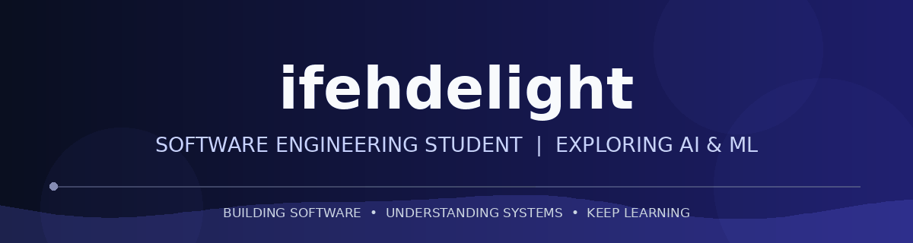

 

---

## About Me

I'm a Software Engineering student at the **Federal University of Technology, Akure (FUTA), Nigeria**.

I'm interested in building meaningful products, understanding computer science and exploring the intersection of software engineering and artificial intelligence.

I enjoy learning how things work under the hood, experimenting with technologies and turning ideas into functional software.

Currently, I'm strengthening my programming foundations with Python while exploring the broader world of AI and Machine Learning.

---

## Areas of Interest

- Software Engineering and Computer Science.
- Modern web development and application architecture.
- Artificial Intelligence and Machine Learning.
- Deep Learning.
- AI Infrastructure.
- Open Source Software.

I'm particularly interested in understanding the engineering behind intelligent systems.

---

## Technologies & Tools

### Languages

### Frameworks & Technologies

### Developer Tools

---

## Currently Learning

| Area | Focus |
|---|---|
| Python | Programming fundamentals and problem-solving |
| Software Engineering | Computer science and application architecture |
| AI & Machine Learning | Exploring the foundations |
| Deep Learning | Long-term area of interest |
| AI Infrastructure | Long-term area of interest |

---

## Featured Project

### Siteversity

**A content-focused blogging platform inspired by modern digital publications.**

Built around the idea of making quality content accessible through a clean, modern reading experience.

 

---

## Open Source

I believe open source is an important part of software engineering and technological advancement.

I'm interested in:

- Exploring and understanding existing codebases.
- Learning from experienced developers.
- Contributing to meaningful open-source projects.
- Collaborating with other developers.
- Building tools that solve real problems.

---

## GitHub Activity

 

---

## Let's Connect

Interested in software engineering, artificial intelligence, open source or building interesting things?

I'm always open to meaningful conversations and collaborations.

 

  

*"Understand deeply. Build thoughtfully. Keep learning."*

